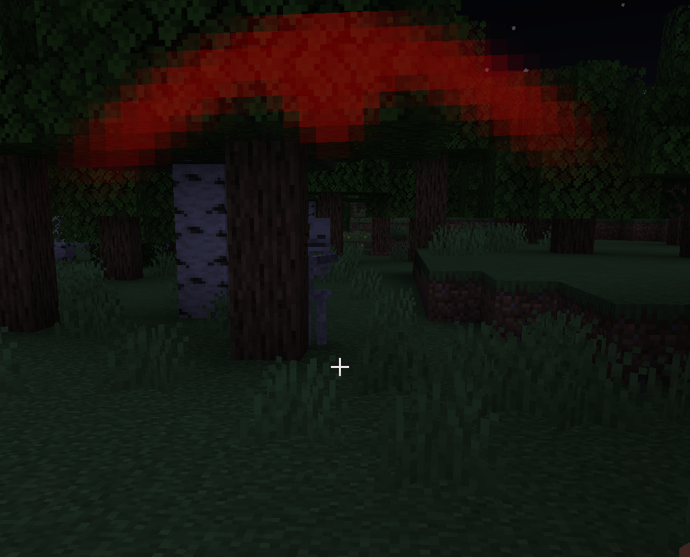
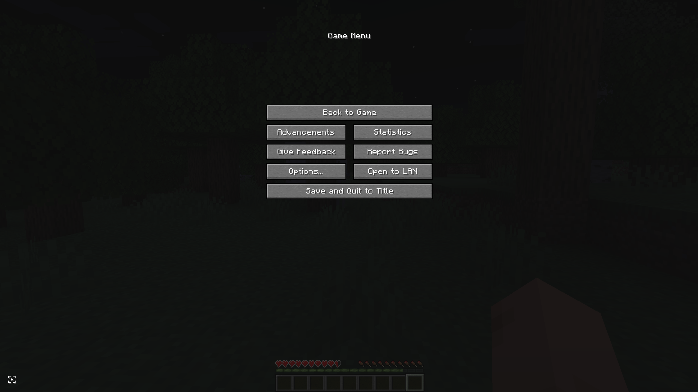
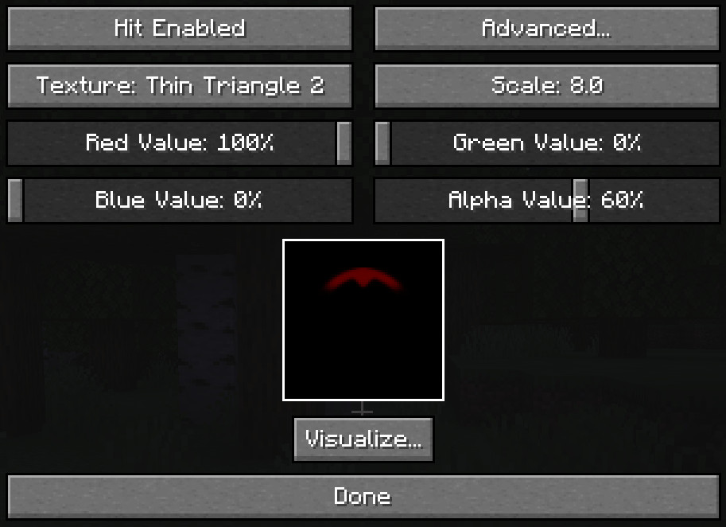
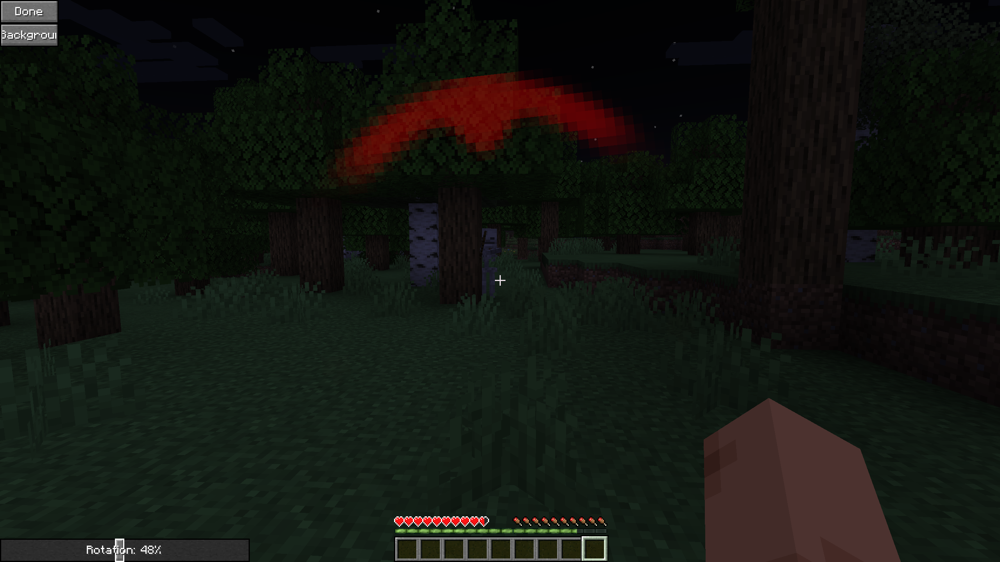

# Shuu's Customizable Hit Indicator

A damage indicator that shows you the approximate position of the enemy you are getting hit from. 

## Features

### Customizability
This mod is very customizable through a custom UI that can be found in the bottom left corner of the pause menu:

You can then adjust values as you see fit:

**There are many options for hit indicators; I recommend clicking through and viewing them all!**.

### Visualizer

Then, you can also visualize what the indicator looks like on your screen:

## For Modders

Adding more hit indicator textures is super easy. In the class `HitIndicatorTextures.java`, there is a function called `addTexture`; use this to add textures. Make sure to load your mod after this one, and run this function in your mod initialization. This will hook it in, and will later cache the name with the texture. 

## Note on AI

This project only used tab completion AI, and AI for research. This mod was not slopped, and was made by a human. 

Low quality AI PRs will be denied.